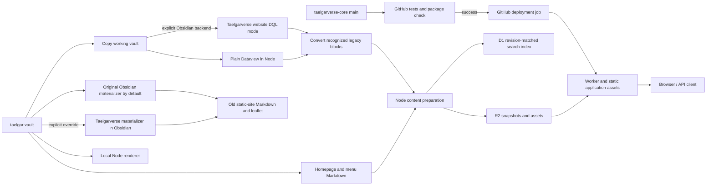

# Architecture and maintenance

TaelgarVerse renders vault Markdown for a selected in-world date and campaign.
The same application runs locally in Node and on Cloudflare Workers. Website
code, published vault content, and the Taelgarverse Obsidian plugin have
independent release paths.

## Documentation map

| Document | Owns |
| --- | --- |
| [Deploy](deploy.md) | Human instructions for publishing content, credentials, local previews, and recovery. |
| [Publishing pipelines](publishing-pipelines.md) | Static-site materializer selection, Node/default and Obsidian website DQL backends, bundle acquisition, and compatibility rewrite rules. |
| [Architecture](architecture.md) | Component boundaries, code map, and maintenance rules for agents. |
| [Vault usage](vault.md) | Which vault files and fields are consumed, rendering semantics, and limitations. |
| [Cloudflare](cloudflare.md) | Current hosted topology, bindings, storage layout, and operational behavior. |
| [Search publication](search.md) | Production D1 compiler, visibility rules, revision staging, readiness, and rollback contract. |
| [Agent plugin releases](obsidian-releases.md) | Agent-driven change review, version policy, release notes, local/BRAT testing, and GitHub publication. Discovered through root `AGENTS.md`. |
| [Index registry v1 YAML reference](index-registry-proposal.md) | Implemented registry schema, fields, filters, relationships, profiles, headers, and display reference. |

[Roadmap](roadmap.md) is a planning artifact. Keep its proposals distinct from
implemented behavior.

[Generated Taelgar bio block](shared-taelgar-blocks-plan.md) records the narrow
implementation scope. Syntax and behavior belong in [vault usage](vault.md#generated-bio-block).

## Components and flow

- **`taelgar`** owns Markdown, media, homepage text, menu structure, campaign identity, display metadata, trusted
  legacy CustomJS rules, and the old static workflow's CLI bridge. Publishing prepares copies;
  it does not rewrite source notes.
- **`taelgarverse-core`** owns rendering, routing, navigation behavior, browser assets, the
  publisher, the Taelgarverse Obsidian plugin source, and the maintained shared
  header core. The deployment job needs this repository and its dependencies;
  it does not need a vault checkout or Obsidian. The preceding test job checks
  out sparse public vault inputs, and must pass before deployment starts.
- **`taelgarverse` / the older static publishing pipeline** are independent of
  this application. Their MkDocs output and materialized static headers are not
  inputs to the dynamic renderer.

| Code | Responsibility |
| --- | --- |
| `scripts/publish-content.mjs`, `scripts/materialize-website.mjs` | Git checkpoint, working vault copy, explicit DQL backend selection (Node default, optional Obsidian), compatibility conversion, image optimization, upload, then activation. No automatic engine fallback. |
| `scripts/materialize-website-dataview.mjs`, `src/dataview-node/`, `scripts/website-working-vault.mjs` | Copy source inputs and original file timestamps, prune underscore/`.nopublish` subtrees before copying, index the remaining working vault, and evaluate DQL in Node using a pinned Dataview bundle. No desktop process. |
| `src/dataview-node/bundle.mjs`, `scripts/cache-dataview.mjs` | Exact GitHub release pin, checksum verification, atomic local dependency-cache downloads, offline reuse and explicit bundle validation. The Node default never reads the vault's Dataview installation/settings. |
| `scripts/convert-website.mjs`, `src/website-compatibility.mjs` | Separate conversion stage: normalize known headers and parse complete recognized DataviewJS table patterns into native blocks; report unmatched code before applying existing cleanup policy. |
| `obsidian/taelgarverse/features/materializer.mjs`, `obsidian/taelgarverse/materializer/`, `scripts/materialize-static.mjs` | Old static-site export: native blocks become Markdown, taelgar-map becomes leaflet, and legacy DQL/DataviewJS/CustomJS behavior is preserved. See [publishing pipelines](publishing-pipelines.md). |
| `scripts/export-dataview.mjs`, `src/dataview-export.mjs`, `obsidian/taelgarverse/features/exporter.mjs` | Versioned website DQL request service exposed through the new materializer. The Obsidian backend delegates selected closed DQL to Dataview without the Node chronology filter; static/website requests share the materializer lock. The plugin-root API remains a compatibility alias. |
| `scripts/publication-progress.mjs` | Phase status, elapsed time, optional local timing records, and ten-second progress reminders around publishing operations; timers stop on success or failure. |
| `scripts/upload-content.mjs`, `scripts/cloudflare-client.mjs` | Separate incremental asset and snapshot transfers, bounded retries, request pacing, and shared refreshable Cloudflare credentials. Used by full and manual publication. |
| `scripts/dev.mjs`, `scripts/test.mjs`, `.github/workflows/tests.yml` | Public development/test entry points, live-vault watching, full local publication preview, plugin installation, and GitHub test/package gates. |
| `.github/workflows/website.yml` | Reuse CI tests, then deploy Worker/static assets on `main`. Serialize production pipelines; deployment credentials are available only in the deployment step. See the one-time cutover in [Deploy](deploy.md#one-time-github-website-deployment-setup). |
| `scripts/prepare-cloudflare.mjs`, `src/publication-markdown.mjs`, `src/markdown-fences.mjs` | Orchestrate DQL first, compatibility conversion and remaining JavaScript cleanup second, then package metadata, Markdown shards, homepage/menu Markdown, and hashed assets into a revision. |
| `scripts/compile-runtime.mjs`, `src/runtime-format.mjs` | Compile versioned lookups, availability, campaign contexts, navigation views, parsed notes and separate route manifests during publication. No HTML prerendering. |
| `scripts/derivative-cache.mjs` | R2 recipe catalog for responsive images/map pyramids, output inventory validation, and publication of reusable records after successful asset uploads. Local/offline consumers retain filesystem generation. |
| `scripts/build-images.mjs` | Responsive-image recipes, bounded parallel generation, cache-reuse counts, and deterministic asset registration. See [image delivery](images.md#publication-and-caching). |
| `scripts/compile-search.mjs`, `src/search-text.mjs` | Compile deduplicated whole-note text versions and date/campaign/DM visibility rules. |
| `scripts/search-index.mjs`, `scripts/search-database.mjs`, `scripts/search.mjs` | Immutable D1 staging, verification, remote/local adapters, and explicit staging CLI. |
| `scripts/content-retention.mjs`, `scripts/maintain-content.mjs` | Coordinated R2/D1 retention of active plus one previous good snapshot; shared publication lock, orphan cleanup and verified rollback. Local R2 inventories are serialized inside the emulator to avoid blocking Node on native object proxies. |
| `src/search.mjs`, `src/search-types.mjs`, `src/local-search.mjs`, `src/search-view.mjs` | Read-only context/revision/type-filtered D1 queries, metadata-based exact-name ranking and type classification, identical local SQLite search, page-name fallback, and escaped result/excerpt rendering. See [search](search.md). |
| `src/store.mjs`, `src/content-store.mjs` | Local filesystem scan, YAML parsing, page/asset lookup, shared availability rules. |
| `src/folder-exclusions.mjs` | Discover original-vault `.nopublish` folder markers for local indexing, export packaging, and publication fingerprints. |
| `src/snapshot.mjs` | Load the R2 index and fetch/cache Markdown shards on demand. |
| `src/runtime-snapshot.mjs` | Select compiled or legacy snapshots; lazily load route data and verify/cache prepared notes and asset manifests. |
| `src/page-cache.mjs` | Worker-only HTML response caching, keyed by publication/build identity and full URL; browser ETag revalidation. |
| `src/application.mjs` | Shared Fetch API router: homepage, articles, search HTML/JSON, contexts, navigation, assets, health. |
| `src/render-engine.mjs` | Resolve context/page, generate header, filter comments, render Markdown and page shell. |
| `src/article-layout.mjs` | Shell-only prose grouping and semantic media breakouts, retaining float contexts and embedded-note boundaries. |
| `src/homepage.mjs`, `public/homepage.css`, `public/images/home-map.webp` | Homepage composition, entry buttons, responsive layout, and decorative map asset. Introductory content remains in the vault's `_website/home.md`. |
| `src/contexts.mjs`, `src/navigation.mjs` | Session-derived dates and context-filtered navigation. |
| `src/backlinks.mjs` | Index authored incoming links and filter them by source availability and visible comment states. |
| `src/recap-parser.mjs`, `src/session-interactions.mjs`, `src/campaign-interactions.mjs`, `src/campaign-ownership.mjs`, `src/interaction-view.mjs`, `src/browser/interactions.mjs`, `src/browser/interaction-groups.mjs` | Shared session-header/Cast parser, campaign ownership, session interaction model and dot controls; Node-only recap file discovery stays in `session-interactions`. See [campaign interactions](campaign-interactions.md). |
| `src/embeds.mjs` | Expand visible note/heading/block embeds, bound recursion, preserve source-relative rendering, and isolate anchors/popups. |
| `src/maps.mjs`, `src/map-distance.mjs`, `src/map-path.mjs`, `src/browser/map-view.mjs`, `src/browser/map-measurement.mjs` | Map rendering, calibration read from vault `leaflet` blocks, flat point/stroke routes, and shared measurement controls. See [maps](maps.md). |
| `obsidian/taelgarverse/`, `scripts/build-obsidian.mjs`, `scripts/install-obsidian.mjs`, `scripts/release-obsidian.mjs` | Unified desktop plugin with Maps and opt-in Images. Features share core modules and own their Component cleanup; plugin `images.css` owns inline image placement and sizing, scoped by the Images feature. Self-contained releases go to `msackton/taelgarverse-obsidian` for BRAT; installed artifacts stay outside vault Git. See the [plugin guide](../obsidian/taelgarverse/README.md). |
| `src/browser/image-viewer.mjs`, `src/browser/image-controls.mjs`, `src/browser/images.mjs`, `public/image-viewer.css` | Shared website/Obsidian image viewer, per-image controls and cleanup. The website entry point is bundled by `scripts/build-browser.mjs`; the Obsidian adapter owns Reading View roots and its host-provided CodeMirror Live Preview extension. See [image delivery](images.md). |
| `scripts/prepare-obsidian-release.mjs` | Read published source provenance, report changes for agent review, prepare version/compatibility/notes files, and validate offline. No Git writes or publication; the uploader also validates the release-note version heading. |
| `src/comments.mjs`, `src/markdown.mjs`, `src/dm.mjs` | Conditional prose, Obsidian syntax, link handling, Behind the Curtain notes. |
| `src/engine.mjs`, `src/server.mjs` | Node initialization and HTTP adapter, using the same header core as the Worker. |
| `src/header-core/` | Maintained dates, names, whereabouts, affiliations, templates, encounters and header output. `createHeaderSnapshot` freezes shared inputs; `createHeaderContext` creates request-local services; `renderBio` renders the complete header directly; `renderHeader` supports saved headers. |
| `src/bio-block.mjs`, `obsidian/taelgarverse/features/headers.mjs` | Leading header-block recognition, pure publication normalization, and the Obsidian adapter. The host selects the date and resolves links; the shared core renders the title and a static native callout. |
| `obsidian/taelgarverse/features/interactions.mjs`, `obsidian/taelgarverse/features/interaction-data.mjs` | Native vault metadata/link adapter, cached recap index, explicit interaction blocks, automatic Reading View footer and host-owned CodeMirror Live Preview widget. Known-to pages get a campaign picker; no note writes or website requests. |
| `src/index-registry.mjs`, `src/index-fields.mjs`, `src/index-registry-node.mjs`, `src/indexes.mjs`, `src/index-columns.mjs`, `src/index-view.mjs`, `src/website-indexes.mjs` | Vault-owned named queries, one host-specific profile, validation, flat filters, home/affiliation/watershed relationships, columns/card positions and typed sorting. Header probes use metadata; hosts load requested body/image content and enforce visibility. Effective website definitions travel with content revisions; Obsidian refreshes local profiles independently. See the [YAML reference](index-registry-proposal.md). |
| `src/campaign-calendar.mjs`, `src/campaign-calendar-context.mjs`, `src/lunar.mjs`, `src/browser/campaign-calendar.mjs`, `public/calendar.css`, `obsidian/taelgarverse/features/calendar.mjs` | Opt-in campaign-date calendar with DR date/month helpers, lunar phases, and normal Obsidian campaign/custom-date settings. Disabled by default; the component owns its active listeners and date API. A metadata-only adapter reuses website Contexts and exposes the date API for headers, indexes and CustomJS. The DOM view shows campaign dots and daily moon illumination; lunar crossings use the adopted full-moon anchor and exact three-hour ticks. The legacy CustomJS hook is an uncommitted experimental-vault change; no website route exists yet. See [campaign calendar](vault.md#campaign-calendar-prototype). |
| `src/worker.mjs`, `src/worker-handler.mjs`, `src/snapshot.mjs` | Worker adapter, content snapshot loading and shared-core initialization. |
| `src/headers.mjs`, `src/header-runtime.mjs`, `src/worker-headers.mjs` | Preserved legacy VM/generated reference implementations for characterization tests. Production rendering does not import them. |
| `scripts/build-runtime.mjs`, `scripts/build-worker-headers.mjs`, `scripts/header-core-revision.mjs` | Legacy reference/icon maintenance and a separate source fingerprint for the maintained core in publication diagnostics. |
| `public/`, `src/browser/`, `scripts/build-browser.mjs` | Application styles/scripts and the generated Leaflet/Mermaid browser assets; Wrangler builds these before packaging. |
| `public/search-overlay.js` | Search suggestions attached to the original query field, context/type preservation, keyboard controls, and stale-request cancellation. |
| `public/quiet-library.css`, `public/site-ui.js`, `public/appearance.js` | Quiet Library layout, responsive dialogs and scroll controls, and browser-local System/Light/Dark appearance. |
| `src/release-footer.mjs`, `public/release.js`, `scripts/build-core-release.mjs` | Version footer, copy behavior, and core provenance captured by Wrangler's custom build. |
| `experiments/ai-search/` | Isolated D1 full-text baseline and optional AI Search pilot: allowlisted exports, usage limits, explicit independent syncs, local viewer, fallback, and repeatable comparisons; no production imports. |
| `experiments/dataview/` | [Local DQL comparison harness](../experiments/dataview/README.md): Node/plugin comparisons using the same maintained Node Dataview adapter as publication. Captured-index replay isolates engine compatibility from filesystem metadata differences; timeline corpus excluded. |

## Configuration

The page shell uses Quiet Library typography with the Sage & stone palette.
`src/header.mjs` owns header controls, dialogs, and search suggestion markup; `src/navigation.mjs`
renders context-filtered section links and the lazy navigation tree. Browser
code moves navigation and context controls into dialogs below 1100px. Search
uses the original field with a nonmodal suggestions dropdown; its phone icon
reveals the field in the header. Backlinks use the right sidebar even without a contents list, and remain
accessible below the article on mobile. Material CSS still provides article
components; the Quiet Library stylesheet overrides its colors with shared light/dark tokens.
Appearance defaults to the operating system, is applied before styles load, and
explicit choices persist in `localStorage` under `taelgarverse-appearance`.
This preference does not alter content context or server caching.

The shell allows up to 2000px including navigation, page navigation, and gutters.
Article prose stays within 80ch; consecutive ordinary blocks share a flow root
so floated portraits still wrap with their associated text. Semantic maps, heroes,
galleries, large figures, and Mermaid diagrams use the available article column.
Small diagrams retain their intrinsic size. The homepage keeps its separate
composition, and API article fragments retain their original structure.
Authoring and the exceptional `layout: wide` override are specified in
[vault usage](vault.md#article-width).

The homepage route passes the rendered, context-filtered `home.md` through
`src/homepage.mjs` before the shared page shell. Its heading and lead paragraph
form the banner; remaining prose is kept intact below the three entry links.
The entry destinations use indexed metadata for visibility and URL context,
without fetching extra article bodies. Search requests (`/?q=`, including an
empty query) retain the page-finder layout. Homepage CSS loads only for the
homepage. The decorative WebP is a 1600px derivative of the existing TaelgarVerse
`overrides/assets/images/banner-map.png` reference asset; it is checked into core
and served through the theme asset allowlist, independently of vault snapshots.

`config.json` owns shared vault/content defaults. `loadSettings()` automatically
applies the ignored `config.local.json` when present; local files need only changed
values. An explicit filename (the publisher's `--config`) or `TAELGARVERSE_CONFIG`
selects an alternative to the local file, in that order of priority. Defaults
still apply. Resolve each path relative to the file that supplies it, so a file
in another directory cannot accidentally relocate inherited paths.

`vault_dir` selects the original vault for content and metadata. Compatibility
tests also read its trusted legacy scripts; production header logic lives in core.
The optional `source_dir` selects different Markdown/media for exported previews;
when omitted or null, it follows the resolved vault. The publisher's `--vault`
overrides `vault_dir` before checking filesystem paths, then the export step
supplies its temporary `source_dir`. For compatibility, the loader converts old
`runtime_dir` keys to `vault_dir` within each settings file before merging them.
The application uses only `vault_dir` and the resolved `source_dir`.

The default `nav_source` and `home_source` follow the resolved `vault_dir` to
`_website/navigation.md` and `_website/home.md`. They always come from the original
vault, including during export packaging. Explicit overrides resolve relative
to their settings file; missing files fail configuration loading. Explicit null
selects directory navigation or the old page-finder homepage, respectively.
The publisher fingerprints both files so changes cannot be skipped as unchanged.
`src/website-sources.mjs` also discovers opted-in `_website/<name>.md` files
from the original vault, using an explicit `subdomain` or the filename as the
host label and rejecting duplicates. `src/campaign-sites.mjs` validates their campaign
selections, dates, and optional `enforcePoV` policy and selects sites by hostname. Sources enter the publication fingerprint, image-usage
scan, and optional `campaignHomes` revision-index field. The shared application
enforces the hostname's context per request without mutating the cached engine.
See [campaign landing pages](campaign-sites.md) for authoring and routing.

Cloudflare account/resource settings remain in `wrangler.json` and the optional
`wrangler.local.json`; they are independent of the vault settings. The supported
keys and examples belong in [deploy](deploy.md#configuration-settings). Changes
to file selection, merging, or path resolution must update that guide and the
configuration tests in `tests/config.test.mjs`.

## Runtime boundaries

Each render resolves a date/campaign and checks page availability before loading
the body. It then regenerates the header, filters comments/conditional blocks,
and renders HTML. Search, navigation, and internal-link availability use the same
metadata rule, including the reader's optional POV date restriction. The
publisher stores the site default in the snapshot. The compiler retains both
POV modes, and search applies the reader's metadata visibility before pagination.
Reader choices stay request-local and never mutate the shared engine.
These rules are specified in [vault usage](vault.md).

Person campaign histories use authoritative recap Cast `met` membership to select
one encounter per session, with supplementary backlinks from non-session
campaign-folder articles. Session notes supply display metadata and optional
full-session links; sessions without a recap use explicit links
in the official session note as separately labeled session references. Original
`_sessions` files remain outside the article store; only session-header fallback
metadata and resolved Cast membership enter the revision index. Beats, Short/Long
text, and transcripts are ignored. The Worker requires no session-body reads. Older publications
retain authored headers and non-session campaign references. See [campaign interactions](campaign-interactions.md).

Compiled runtime render data carries the same session interaction projections as
the legacy index. Legacy transcript descriptors remain readable by snapshot
storage, but new publications produce no transcript shards or links.
Older compiled publications without an
interaction projection derive non-session references from the request's target
backlink shard, keeping the shared engine immutable.

`RenderEngine.renderHome()` applies the shared comment and Markdown renderer to
the authored homepage, without generating an article header or indexing it as a
note. The root route uses it unless a `q` parameter requests search. Homepage and
menu sources live in the revision index, separate from article shards. The
schema-1 `homeSource` field is optional so older publications retain the page
finder; a supplied value must be a string or null. Deploy the updated core and
publish content to enable the homepage, in either order. Both website source
files are read explicitly; the normal underscore-folder exclusion stays in place.

Header calculations need metadata from the whole indexed vault for names,
locations, and relationships. The adapters share frozen metadata but create fresh
date, name, location, affiliation, template and output services per render.
Snapshot alias indexes preserve native resolution and stable alias order without
repeated vault scans. A reverse affiliation index narrows leadership queries; the maintained affiliation
service applies the query date. Unexpected affiliation shapes fall back to a
full scan. The core needs no app/Dataview shim, global calendar or CustomJS state.

Header refactoring is guarded by synthetic unit tests, frozen examples of every
vault `testcase` page, complex relationship histories, fixed outputs in both
formats, and independent comparisons with the original vault classes. Fixture
updates and known pre-existing defects are described in the
[refactoring test baseline](shared-taelgar-blocks-plan.md#refactoring-test-baseline).

Generated indexes cache only immutable candidate/path lookups on the metadata
snapshot; dated relationships and website visibility remain query-local. The
Obsidian adapter additionally retains up to 32 author-view queries per snapshot,
keyed by date, source, target, type, and containment. Renders receive independent
result copies, and metadata changes replace the snapshot and its cached queries.
Header buttons run only a first-match existence probe. Popup bodies are built on
activation; the shared popup controller coalesces loads, retries failures, and
ignores completion after disposal. Website grids use the read-only `/api/index`
route with the source page's visibility and hostname-locked reader context.
Compiled Workers initialize rendering metadata for that route. Members grids
then load only the visible members' note bodies through the existing shard
loader, sharing a request-local cache with embeds. Tables and the other index
types use metadata only; header buttons do not load candidate bodies. The local
Node adapter already has note bodies and prepares lead-image derivatives on demand.

The Obsidian bio adapter supplies the host's link resolver to the shared header
runtime, then reads the destination's frozen snapshot metadata. This preserves
Obsidian's disambiguation when location and homepage filenames overlap; Node and
Worker retain their published-content lookup rules.

Node, Worker and Obsidian all import the maintained shared core. The legacy VM
adapter uses `node:vm` only in reference tests; it is not a sandbox for arbitrary
scripts. Circular location/organization chains produce a clear header error,
including when a type filter would otherwise prevent the depth limit advancing.
Body Dataview/JavaScript is not executed by either renderer. Supported
Dataview queries are materialized during publication and do not rerun when a
visitor changes context.

The new website publisher copies source files into a request-owned working vault,
materializes supported plain DQL in Node by default or through the explicitly
selected Taelgarverse Obsidian materializer's DQL mode, then runs compatibility conversion
before any image discovery, backlinks, search or runtime compilation. The
conversion recognizes complete supported JavaScript syntax without executing it.
Native blocks remain dynamic at render time. Unrecognized DataviewJS follows the
existing omission policy and is reported. Original notes are never rewritten.
The Node backend downloads an exact pinned GitHub Dataview release on first DQL
use and verifies/reuses its core-local cache offline. It uses built-in settings
without reading the vault's Dataview installation. `--dataview-directory` is an
explicit bundle/settings override that bypasses downloading. Neither cache
availability nor its machine path changes the default fingerprint; the release
pin and settings policy do. Obsidian need not be installed or running.
The Obsidian backend requires the source vault open and the updated plugin loaded.
Both leave native blocks and legacy JavaScript intact until Node conversion.
Backend selection, the default pin, and explicitly selected/installed bundles
participate in the fingerprint.
Direct `prepareContent` calls use the same ordering and can supply a materialization
callback; without one, DQL remains unavailable at render time.

The old static site retains its original vault CLI and standalone Obsidian
materializer by default. The wrapper's `TAELGAR_MATERIALIZER` override can select
core's `scripts/materialize-static.mjs` explicitly. That Taelgarverse feature
preserves the legacy CustomJS/DQL/DataviewJS path while adding native-block
Markdown renderers and a taelgar-map-to-leaflet conversion. Both static choices
feed the same legacy exporter and MkDocs/GitHub Pages publication path.
See [publishing pipelines](publishing-pipelines.md) for commands and boundaries.

Generated `taelgar-index` fences and frontmatter `indexes` arrays query the
existing frozen header metadata at render time. They reuse dated whereabouts
and affiliation services with host-provided resolution and visibility, requiring
no extra snapshot format. Only Members grid descriptions require note-body reads,
so existing published snapshots work without republication. The website filters candidates
before counts and links, including formatted person info, location and home destinations.
People and member tables reuse header templates and resolve their text/wikilink output into
escaped text and host links. Member descriptions apply the reader's comment
visibility before selecting the first ordinary Markdown paragraph, skipping
callouts and other non-prose blocks. The shared extractor returns escaped plain
text in the view; it does not render or expand embedded notes. Grid images use
the existing `image` metadata field; publication includes those references in
the responsive-image usage plan. Search/backlink compilation omits these generated rows;
inline indexes retain the containing note as their source inside transclusions.
Header buttons belong only to the new `taelgar-header` renderer, after its complete
output and outside the information callout. No general heading postprocessor adds
buttons to ordinary titles or saved headers.
Obsidian shares the bio snapshot, invalidates it on vault metadata changes, and
owns popup listeners/dialogs through its Markdown child lifecycle. The plugin-local
`headerIndexPopups` setting defaults to true; disabling it suppresses header
buttons and disposes open dialogs immediately without changing inline indexes,
note metadata, or the website renderer.

The Worker reads the R2 publication pointer on content requests. Successful
article and homepage HTML can then be served from Cloudflare's Cache API before
initializing the snapshot. Cache keys include the exact URL, content revision,
activation metadata, and website build identity; browser responses revalidate
with ETags. Cache misses replace snapshot state when the revision changes.
New publications include a small runtime
manifest: health and contexts need no article data; assets load a partitioned
asset index; search uses compact metadata; articles initialize the renderer from
compiled lookups and header indexes, reusing those entries for navigation without
loading search metadata. Runtime format 2 uses shared note-shard descriptors,
revision-local numeric page IDs in target-grouped backlink shards, and deduplicated
navigation bitmaps. Prepared notes contain parsed bodies rather
than requiring request-time YAML parsing. Backlink loading is asynchronous and
request-local; the synchronous Node renderer still uses its full backlink index.
Artifact hashes are verified on load,
with shared pending reads and a bounded 16-object data cache. Navigation compiles
named-context visibility for both POV modes; custom views are calculated on
demand in a bounded 32-view cache. Request context and active-page selection stay
separate from shared visibility data. Node reads a filesystem snapshot at startup and must restart
after vault, runtime, settings, homepage, or menu changes. Node responses remain
uncached. HTML is rendered on demand; publication does not prerender pages.
The `dev` supervisor restarts Node after vault/source changes; full preview
uses a prepared snapshot and must be rerun after vault edits.
[Cloudflare](cloudflare.md) owns the hosted storage/request details.

## Relationship explorer

The opt-in Obsidian relationship explorer owns its workspace view, lazy prose
reads, native link resolution, and event cleanup in
`obsidian/taelgarverse/features/relationships.mjs`. It reuses the immutable
header snapshot and affiliation/location services. Social relationships accumulate
through the cutoff; the spatial view uses current/last-known whereabouts. The shared comment parser exposes source spans
for date-aware prose evidence without changing website comment visibility.
The author-only graph
includes unpublished local notes; it does not serve website requests.

`src/relationship-graph.mjs` owns typed nodes/edges, prose evidence, and filtering;
`src/relationship-layout.mjs` owns deterministic network, hierarchy, and
map/schematic placement. `src/place-tree.mjs` owns canonical, cycle-safe containment and implicit Material Plane roots;
`src/browser/place-boxes.mjs` owns expandable boxes, contained people, paging, and responsive schematic route lines.
`src/place-routes.mjs` extracts explicit road/river endpoints from typed map metadata;
route edges never establish containment.
`src/place-appearance.mjs` maps structured place types to icons and color accents.
`src/browser/relationship-explorer.mjs` and
`public/relationships.css` own the view, its full-window dialog lifecycle, and on-demand details. The UI
always follows the active campaign date and uses network for People and nested containment boxes
for Places; connection depth and per-organization traversal switches control reach. Styles are bundled only
into the plugin.
See the [explorer guide](relationship-explorer.md) for authoring, behavior, and
prototype limitations. The offline preview script uses synthetic data.
Inline `taelgar-relationship` blocks share the feature lifecycle and graph cache;
`src/relationship-block.mjs` validates their mode, and
`src/browser/relationship-list.mjs` owns the compact list presentation.

## Change and release rules

| Change | Required release action |
| --- | --- |
| Vault Markdown/media, session notes, registry, `.obsidian/metadata.json` | Run the content publisher. |
| Index registry YAML or selected publisher profile | Republish content. Only the effective website registry is stored and fingerprinted. First-time use of this schema also requires the updated website/plugin code. |
| Add or remove a folder's `.nopublish` marker | Republish content; the publisher fingerprints the original-vault markers and excludes matching exported subtrees before packaging and search compilation. |
| Structured session recap fields used by campaign interactions | Republish content; recap projections are revision-bound, and parsed source fields participate in the publisher fingerprint. |
| `_website/home.md`, `_website/navigation.md`, `home_source`, `nav_source`, `default_date`, `respect_pov_dates`, materializer, packaging, image settings | Republish content; use `--force` if the change is outside the publisher's fingerprint. A core merge alone does not refresh the published homepage or menu. |
| Renderer, routes, CSS/browser scripts, dependencies, Worker configuration | Merge core changes to `main`; GitHub deploys to Cloudflare after CI passes. |
| Taelgarverse plugin or shared map code used by it | Test both consumers, bump the plugin's own version, then explicitly release to the BRAT distribution repository. A website deployment does not release the plugin. |
| Maintained shared header core | Test Node, Worker and Obsidian; use the website code release path and a separate explicit plugin release. Content publication does not deploy header code. |
| Vault CustomJS header classes | These remain the legacy materializer/reference stack. They do not update the maintained core. Refresh a legacy fixture only as a deliberately reviewed reference change; do not backport the refactor's fixes. |
| Snapshot schema or publication/availability policy | Update producer and consumers together; determine a compatible deployment order and whether existing snapshots must be republished. |
| Search compiler, visibility rules, or index format | Republish content to compile/stage D1 before activation; retain active plus one previous good generation in R2/D1 and collect orphaned assets/text. See [search publication](search.md). |

`node scripts/build-runtime.mjs` regenerates the local legacy reference at
`.generated/headers.mjs` and `src/icons.mjs`; it does **not** update the maintained
header core or the committed legacy `src/worker-headers.mjs` reference.
`build-worker-headers.mjs` is retained only for intentional legacy-reference
maintenance. Normal application and plugin builds bundle `src/header-core/`.
`public/generated/` is ignored and rebuilt from the pinned browser dependencies.
Core provenance is also generated locally under `.generated/` by Wrangler before
packaging. Content source commits travel with snapshots, while publication dates
come from their activation pointers; see [footer provenance](cloudflare.md#how-updates-reach-the-site).

Image cache maintenance is also mandatory: any generation algorithm, output
format, or compression-logic change in `scripts/build-images.mjs` must bump the
recipe `version` in its cache-key calculation in the same change. This includes
changes to shared helpers that affect generated images. Apply the same rule to
the separate recipe version in `scripts/build-maps.mjs` for map tiles. Settings
values and source bytes already participate in these keys; code edits do not.
The publication fingerprint and `--force` trigger a build but do not bypass these
derivative caches. Comment-only edits and scheduling/logging changes that
preserve generated bytes and recipes do not require a recipe bump.
The R2 catalog uses those same recipe keys. Keep cache metadata out of the
published index, verify referenced output keys and sizes before reuse and upload,
and save records under the publication lock only after their assets exist.
Cache records must not become retention roots. See [asset caching](deploy.md#incremental-assets-and-interrupted-uploads).

Agents must update the relevant core docs in the same change:

- Update **deploy** for changed commands, prerequisites, authentication, flags,
  checkpoint/recovery behavior, or release steps. Verify examples against
  `package.json` and the scripts; distinguish local commands from remote writes.
- Update **cloudflare** for changed resource names, bindings, domains, build
  configuration, object layout, caching, or observability. Cite code for configured
  behavior and dated live evidence for deployed facts. Mark unverified dashboard
  settings as such; never record credentials or infer a completed deployment.
- Update **vault** for changed file selection, metadata, contexts, comment syntax,
  links, query handling, or media support. Check both export and request behavior.
- Update **architecture** when ownership, module boundaries, or the release rules
  change. Link to the owning doc instead of copying its detailed rules. Remove
  superseded prose and repair inbound links. Leave the roadmap untouched unless
  changes to it are requested.

For behavior changes, run the relevant tests in `tests/`; use `npm test` for shared
rendering changes and `node scripts/cloudflare.mjs check` for the Worker package. Tests that build
headers need the configured vault. Publisher storage changes also have the local
`node --test tests/publish-r2.integration.mjs` check. Use `node scripts/smoke-worker.mjs` only against
a Worker serving equivalent content/settings to the local reference. Documentation
edits need link/example checks; they do not require publishing content.
