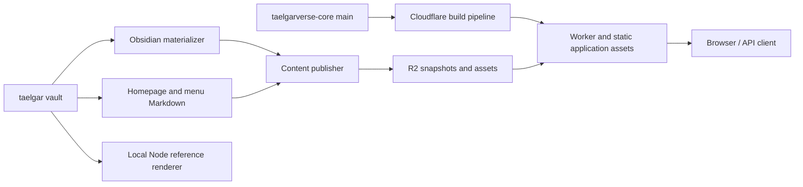

# Architecture and maintenance

TaelgarVerse renders vault Markdown for a selected in-world date and campaign.
The same application runs locally in Node and on Cloudflare Workers. Website
code and published vault content have independent release paths.

## Documentation map

| Document | Owns |
| --- | --- |
| [Deploy](deploy.md) | Human instructions for publishing content, credentials, local previews, and recovery. |
| [Architecture](architecture.md) | Component boundaries, code map, and maintenance rules for agents. |
| [Vault usage](vault.md) | Which vault files and fields are consumed, rendering semantics, and limitations. |
| [Cloudflare](cloudflare.md) | Current hosted topology, bindings, storage layout, and operational behavior. |

[Roadmap](roadmap.md) and [UI review](design/ui-review/README.md) are separate
planning/design artifacts. Keep their proposals distinct from implemented behavior.

## Components and flow

- **`taelgar`** owns Markdown, media, homepage text, menu structure, campaign identity, display metadata, trusted
  CustomJS header rules, and the Obsidian materializer. Publishing exports copies;
  it does not rewrite source notes.
- **`taelgarverse-core`** owns rendering, routing, navigation behavior, browser assets, the
  publisher, and the checked-in Worker header module. Cloudflare builds need this
  repository and its dependencies; they do not need a vault checkout or Obsidian.
- **`taelgarverse` / the older static publishing pipeline** are independent of
  this application. Their MkDocs output and materialized static headers are not
  inputs to the dynamic renderer.

| Code | Responsibility |
| --- | --- |
| `scripts/publish-content.mjs` | Git checkpoint, Obsidian export, image optimization, upload, then activation. |
| `scripts/prepare-cloudflare.mjs` | Package metadata, Markdown shards, homepage/menu Markdown, and hashed assets into a revision. |
| `src/store.mjs`, `src/content-store.mjs` | Local filesystem scan, YAML parsing, page/asset lookup, shared availability rules. |
| `src/snapshot.mjs` | Load the R2 index and fetch/cache Markdown shards on demand. |
| `src/application.mjs` | Shared Fetch API router: homepage, articles, page finder, contexts, navigation, assets, health. |
| `src/render-engine.mjs` | Resolve context/page, generate header, filter comments, render Markdown and page shell. |
| `src/contexts.mjs`, `src/navigation.mjs` | Session-derived dates and context-filtered navigation. |
| `src/backlinks.mjs` | Index authored incoming links and filter them by source availability and visible comment states. |
| `src/embeds.mjs` | Expand visible note/heading/block embeds, bound recursion, preserve source-relative rendering, and isolate anchors/popups. |
| `src/comments.mjs`, `src/markdown.mjs`, `src/dm.mjs` | Conditional prose, Obsidian syntax, link handling, Behind the Curtain notes. |
| `src/engine.mjs`, `src/server.mjs`, `src/headers.mjs` | Node initialization, HTTP adapter, fresh VM context for trusted CustomJS. |
| `src/worker.mjs`, `src/worker-handler.mjs`, `src/header-runtime.mjs` | Worker adapter and fresh instances of generated header classes. |
| `scripts/build-runtime.mjs`, `scripts/build-worker-headers.mjs` | Translate trusted vault classes into ordinary JavaScript modules. |
| `public/`, `src/browser/`, `scripts/build-browser.mjs` | Application styles/scripts and the generated Mermaid browser bundle. |
| `src/release-footer.mjs`, `public/release.js`, `scripts/build-core-release.mjs` | Version footer, copy behavior, and core provenance captured by Wrangler's custom build. |

## Configuration

`config.json` owns shared vault/content defaults. `loadSettings()` automatically
applies the ignored `config.local.json` when present; local files need only changed
values. An explicit filename (the publisher's `--config`) or `TAELGARVERSE_CONFIG`
selects an alternative to the local file, in that order of priority. Defaults
still apply. Resolve each path relative to the file that supplies it, so a file
in another directory cannot accidentally relocate inherited paths.

`vault_dir` selects the original vault for content, metadata, and trusted scripts.
The optional `source_dir` selects different Markdown/media for exported previews;
when omitted or null, it follows the resolved vault. The publisher's `--vault`
overrides `vault_dir` before checking filesystem paths, then the export step
supplies its temporary `source_dir`. For compatibility, the loader converts old
`runtime_dir` keys to `vault_dir` within each settings file before merging them.
The application uses only `vault_dir` and the resolved `source_dir`.

The default `nav_source` and `home_source` follow the resolved `vault_dir` to
`_website/navigation.md` and `_website/home.md`. They always come from the original
vault, including during export packaging. Explicit overrides resolve relative
to their settings file; missing files fail configuration loading. Explicit null
selects directory navigation or the old page-finder homepage, respectively.
The publisher fingerprints both files so changes cannot be skipped as unchanged.

Cloudflare account/resource settings remain in `wrangler.json` and the optional
`wrangler.local.json`; they are independent of the vault settings. The supported
keys and examples belong in [deploy](deploy.md#configuration-settings). Changes
to file selection, merging, or path resolution must update that guide and the
configuration tests in `tests/config.test.mjs`.

## Runtime boundaries

Each render resolves a date/campaign and checks page availability before loading
the body. It then regenerates the header, filters comments/conditional blocks,
and renders HTML. Search, navigation, and internal-link availability use the same
metadata rule. These rules are specified in [vault usage](vault.md).

`RenderEngine.renderHome()` applies the shared comment and Markdown renderer to
the authored homepage, without generating an article header or indexing it as a
note. The root route uses it unless a `q` parameter requests search. Homepage and
menu sources live in the revision index, separate from article shards. The
schema-1 `homeSource` field is optional so older publications retain the page
finder; a supplied value must be a string or null. Deploy the updated core and
publish content to enable the homepage, in either order. Both website source
files are read explicitly; the normal underscore-folder exclusion stays in place.

Header calculations need metadata from the whole indexed vault for names,
locations, and relationships. The adapters share frozen metadata but create fresh
header state per render. A reverse affiliation index narrows leadership queries;
the original classes still decide dates and display text. Unexpected affiliation
shapes fall back to a full scan.

Node uses `node:vm` for trusted header code; it is not a sandbox for arbitrary
scripts. Workers use the committed `src/worker-headers.mjs`, with no runtime code
evaluation. Body Dataview/JavaScript is not executed by either renderer. Supported
Dataview queries are materialized during publication and do not rerun when a
visitor changes context.

The Worker shares an index and bounded Markdown cache within an isolate. It reads
the R2 publication pointer on content requests and replaces that state when the
revision changes. Node reads a filesystem snapshot at startup and must restart
after vault, runtime, settings, homepage, or menu changes. There is no rendered HTML
cache. [Cloudflare](cloudflare.md) owns the hosted storage/request details.

## Change and release rules

| Change | Required release action |
| --- | --- |
| Vault Markdown/media, session notes, registry, `.obsidian/metadata.json` | Run the content publisher. |
| `_website/home.md`, `_website/navigation.md`, `home_source`, `nav_source`, `default_date`, materializer, packaging, image settings | Republish content; use `--force` if the change is outside the publisher's fingerprint. A core merge alone does not refresh the published homepage or menu. |
| Renderer, routes, CSS/browser scripts, dependencies, Worker configuration | Merge core changes to `main`; the Cloudflare pipeline deploys them. |
| Vault CustomJS header classes | Run `npm run build:worker-headers`, review and commit the generated `src/worker-headers.mjs` (and changed generated icons), then merge core to `main`. Content publication does not regenerate or deploy this module. Republish if data also changed. |
| Snapshot schema or publication/availability policy | Update producer and consumers together; determine a compatible deployment order and whether existing snapshots must be republished. |

`npm run build:runtime` regenerates the local `.generated/headers.mjs` and
`src/icons.mjs`; it does **not** update the committed Worker header module.
`public/generated/` is ignored and rebuilt from the pinned browser dependencies.
Core provenance is also generated locally under `.generated/` by Wrangler before
packaging. Content source commits travel with snapshots, while publication dates
come from their activation pointers; see [footer provenance](cloudflare.md#how-updates-reach-the-site).

Agents must update the relevant core docs in the same change:

- Update **deploy** for changed commands, prerequisites, authentication, flags,
  checkpoint/recovery behavior, or release steps. Verify examples against
  `package.json` and the scripts; distinguish local commands from remote writes.
- Update **cloudflare** for changed resource names, bindings, domains, build
  configuration, object layout, caching, or observability. Cite code for configured
  behavior and dated live evidence for deployed facts. Mark unverified dashboard
  settings as such; never record credentials or infer a completed deployment.
- Update **vault** for changed file selection, metadata, contexts, comment syntax,
  links, query handling, or media support. Check both export and request behavior.
- Update **architecture** when ownership, module boundaries, or the release rules
  change. Link to the owning doc instead of copying its detailed rules. Remove
  superseded prose and repair inbound links. Leave the roadmap and UI review
  untouched unless changes to those artifacts are requested.

For behavior changes, run the relevant tests in `tests/`; use `npm test` for shared
rendering changes and `npm run cf:check` for the Worker package. Tests that build
headers need the configured vault. Publisher storage changes also have the local
`node --test tests/publish-r2.integration.mjs` check. Use `cf:smoke` only against
a Worker serving equivalent content/settings to the local reference. Documentation
edits need link/example checks; they do not require publishing content.
