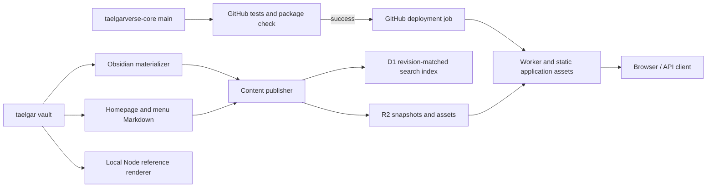

# Architecture and maintenance

TaelgarVerse renders vault Markdown for a selected in-world date and campaign.
The same application runs locally in Node and on Cloudflare Workers. Website
code, published vault content, and the Taelgarverse Obsidian plugin have
independent release paths.

## Documentation map

| Document | Owns |
| --- | --- |
| [Deploy](deploy.md) | Human instructions for publishing content, credentials, local previews, and recovery. |
| [Architecture](architecture.md) | Component boundaries, code map, and maintenance rules for agents. |
| [Vault usage](vault.md) | Which vault files and fields are consumed, rendering semantics, and limitations. |
| [Cloudflare](cloudflare.md) | Current hosted topology, bindings, storage layout, and operational behavior. |
| [Search publication](search.md) | Production D1 compiler, visibility rules, revision staging, readiness, and rollback contract. |
| [Agent plugin releases](obsidian-releases.md) | Agent-driven change review, version policy, release notes, local/BRAT testing, and GitHub publication. Discovered through root `AGENTS.md`. |

[Roadmap](roadmap.md) is a planning artifact. Keep its proposals distinct from
implemented behavior.

## Components and flow

- **`taelgar`** owns Markdown, media, homepage text, menu structure, campaign identity, display metadata, trusted
  CustomJS header rules, and the Obsidian materializer. Publishing exports copies;
  it does not rewrite source notes.
- **`taelgarverse-core`** owns rendering, routing, navigation behavior, browser assets, the
  publisher, the Taelgarverse Obsidian plugin source, and the checked-in Worker
  header module. The deployment job needs this repository and its dependencies;
  it does not need a vault checkout or Obsidian. The preceding test job checks
  out sparse public vault inputs, and must pass before deployment starts.
- **`taelgarverse` / the older static publishing pipeline** are independent of
  this application. Their MkDocs output and materialized static headers are not
  inputs to the dynamic renderer.

| Code | Responsibility |
| --- | --- |
| `scripts/publish-content.mjs` | Git checkpoint, Obsidian export, image optimization, upload, then activation. |
| `scripts/publication-progress.mjs` | Phase status, elapsed time, and ten-second progress reminders around long publishing operations; timers stop on success or failure. |
| `scripts/upload-content.mjs`, `scripts/cloudflare-client.mjs` | Separate incremental asset and snapshot transfers, bounded retries, request pacing, and shared refreshable Cloudflare credentials. Used by full and manual publication. |
| `scripts/dev.mjs`, `scripts/test.mjs`, `.github/workflows/tests.yml` | Public development/test entry points, live-vault watching, full local publication preview, plugin installation, and GitHub test/package gates. |
| `.github/workflows/website.yml` | Reuse CI tests, then deploy Worker/static assets on `main`. Serialize production pipelines; deployment credentials are available only in the deployment step. See the one-time cutover in [Deploy](deploy.md#one-time-github-website-deployment-setup). |
| `scripts/prepare-cloudflare.mjs` | Package metadata, Markdown shards, homepage/menu Markdown, and hashed assets into a revision. |
| `scripts/derivative-cache.mjs` | R2 recipe catalog for responsive images/map pyramids, output inventory validation, and publication of reusable records after successful asset uploads. Local/offline consumers retain filesystem generation. |
| `scripts/compile-search.mjs`, `src/search-text.mjs` | Compile deduplicated whole-note text versions and date/campaign/DM visibility rules. |
| `scripts/search-index.mjs`, `scripts/search-database.mjs`, `scripts/search.mjs` | Immutable D1 staging, verification, remote/local adapters, and explicit staging CLI. |
| `scripts/content-retention.mjs`, `scripts/maintain-content.mjs` | Coordinated R2/D1 retention of active plus one previous good snapshot; shared publication lock, orphan cleanup and verified rollback. |
| `src/search.mjs`, `src/search-types.mjs`, `src/local-search.mjs`, `src/search-view.mjs` | Read-only context/revision/type-filtered D1 queries, metadata-based exact-name ranking and type classification, identical local SQLite search, page-name fallback, and escaped result/excerpt rendering. See [search](search.md). |
| `src/store.mjs`, `src/content-store.mjs` | Local filesystem scan, YAML parsing, page/asset lookup, shared availability rules. |
| `src/folder-exclusions.mjs` | Discover original-vault `.nopublish` folder markers for local indexing, export packaging, and publication fingerprints. |
| `src/snapshot.mjs` | Load the R2 index and fetch/cache Markdown shards on demand. |
| `src/application.mjs` | Shared Fetch API router: homepage, articles, search HTML/JSON, contexts, navigation, assets, health. |
| `src/render-engine.mjs` | Resolve context/page, generate header, filter comments, render Markdown and page shell. |
| `src/article-layout.mjs` | Shell-only prose grouping and semantic media breakouts, retaining float contexts and embedded-note boundaries. |
| `src/homepage.mjs`, `public/homepage.css`, `public/images/home-map.webp` | Homepage composition, entry buttons, responsive layout, and decorative map asset. Introductory content remains in the vault's `_website/home.md`. |
| `src/contexts.mjs`, `src/navigation.mjs` | Session-derived dates and context-filtered navigation. |
| `src/backlinks.mjs` | Index authored incoming links and filter them by source availability and visible comment states. |
| `src/embeds.mjs` | Expand visible note/heading/block embeds, bound recursion, preserve source-relative rendering, and isolate anchors/popups. |
| `src/maps.mjs`, `src/map-distance.mjs`, `src/map-path.mjs`, `src/browser/map-view.mjs`, `src/browser/map-measurement.mjs` | Map rendering, calibration read from vault `leaflet` blocks, flat point/stroke routes, and shared measurement controls. See [maps](maps.md). |
| `obsidian/taelgarverse/`, `scripts/build-obsidian.mjs`, `scripts/install-obsidian.mjs`, `scripts/release-obsidian.mjs` | Unified desktop plugin with Maps and opt-in Images. Features share core modules and own their Component cleanup; plugin `images.css` owns inline image placement and sizing, scoped by the Images feature. Self-contained releases go to `msackton/taelgarverse-obsidian` for BRAT; installed artifacts stay outside vault Git. See the [plugin guide](../obsidian/taelgarverse/README.md). |
| `src/browser/image-viewer.mjs`, `src/browser/image-controls.mjs`, `src/browser/images.mjs`, `public/image-viewer.css` | Shared website/Obsidian image viewer, per-image controls and cleanup. The website entry point is bundled by `scripts/build-browser.mjs`; the Obsidian adapter owns Reading View roots and its host-provided CodeMirror Live Preview extension. See [image delivery](images.md). |
| `scripts/prepare-obsidian-release.mjs` | Read published source provenance, report changes for agent review, prepare version/compatibility/notes files, and validate offline. No Git writes or publication; the uploader also validates the release-note version heading. |
| `src/comments.mjs`, `src/markdown.mjs`, `src/dm.mjs` | Conditional prose, Obsidian syntax, link handling, Behind the Curtain notes. |
| `src/engine.mjs`, `src/server.mjs`, `src/headers.mjs` | Node initialization, HTTP adapter, fresh VM context for trusted CustomJS. |
| `src/worker.mjs`, `src/worker-handler.mjs`, `src/header-runtime.mjs` | Worker adapter and fresh instances of generated header classes. |
| `scripts/build-runtime.mjs`, `scripts/build-worker-headers.mjs` | Translate trusted vault classes into ordinary JavaScript modules. |
| `public/`, `src/browser/`, `scripts/build-browser.mjs` | Application styles/scripts and the generated Leaflet/Mermaid browser assets; Wrangler builds these before packaging. |
| `public/search-overlay.js` | Search suggestions attached to the original query field, context/type preservation, keyboard controls, and stale-request cancellation. |
| `public/quiet-library.css`, `public/site-ui.js`, `public/appearance.js` | Quiet Library layout, responsive dialogs and scroll controls, and browser-local System/Light/Dark appearance. |
| `src/release-footer.mjs`, `public/release.js`, `scripts/build-core-release.mjs` | Version footer, copy behavior, and core provenance captured by Wrangler's custom build. |
| `experiments/ai-search/` | Isolated D1 full-text baseline and optional AI Search pilot: allowlisted exports, usage limits, explicit independent syncs, local viewer, fallback, and repeatable comparisons; no production imports. |

## Configuration

The page shell uses Quiet Library typography with the Sage & stone palette.
`src/header.mjs` owns header controls, dialogs, and search suggestion markup; `src/navigation.mjs`
renders context-filtered section links and the lazy navigation tree. Browser
code moves navigation and context controls into dialogs below 1100px. Search
uses the original field with a nonmodal suggestions dropdown; its phone icon
reveals the field in the header. Backlinks use the right sidebar even without a contents list, and remain
accessible below the article on mobile. Material CSS still provides article
components; the Quiet Library stylesheet overrides its colors with shared light/dark tokens.
Appearance defaults to the operating system, is applied before styles load, and
explicit choices persist in `localStorage` under `taelgarverse-appearance`.
This preference does not alter content context or server caching.

The shell allows up to 2000px including navigation, page navigation, and gutters.
Article prose stays within 80ch; consecutive ordinary blocks share a flow root
so floated portraits still wrap with their associated text. Semantic maps, heroes,
galleries, large figures, and Mermaid diagrams use the available article column.
Small diagrams retain their intrinsic size. The homepage keeps its separate
composition, and API article fragments retain their original structure.
Authoring and the exceptional `layout: wide` override are specified in
[vault usage](vault.md#article-width).

The homepage route passes the rendered, context-filtered `home.md` through
`src/homepage.mjs` before the shared page shell. Its heading and lead paragraph
form the banner; remaining prose is kept intact below the three entry links.
The entry destinations use indexed metadata for visibility and URL context,
without fetching extra article bodies. Search requests (`/?q=`, including an
empty query) retain the page-finder layout. Homepage CSS loads only for the
homepage. The decorative WebP is a 1600px derivative of the existing TaelgarVerse
`overrides/assets/images/banner-map.png` reference asset; it is checked into core
and served through the theme asset allowlist, independently of vault snapshots.

`config.json` owns shared vault/content defaults. `loadSettings()` automatically
applies the ignored `config.local.json` when present; local files need only changed
values. An explicit filename (the publisher's `--config`) or `TAELGARVERSE_CONFIG`
selects an alternative to the local file, in that order of priority. Defaults
still apply. Resolve each path relative to the file that supplies it, so a file
in another directory cannot accidentally relocate inherited paths.

`vault_dir` selects the original vault for content, metadata, and trusted scripts.
The optional `source_dir` selects different Markdown/media for exported previews;
when omitted or null, it follows the resolved vault. The publisher's `--vault`
overrides `vault_dir` before checking filesystem paths, then the export step
supplies its temporary `source_dir`. For compatibility, the loader converts old
`runtime_dir` keys to `vault_dir` within each settings file before merging them.
The application uses only `vault_dir` and the resolved `source_dir`.

The default `nav_source` and `home_source` follow the resolved `vault_dir` to
`_website/navigation.md` and `_website/home.md`. They always come from the original
vault, including during export packaging. Explicit overrides resolve relative
to their settings file; missing files fail configuration loading. Explicit null
selects directory navigation or the old page-finder homepage, respectively.
The publisher fingerprints both files so changes cannot be skipped as unchanged.
`src/website-sources.mjs` also discovers opted-in `_website/<subdomain>.md` files
from the original vault. `src/campaign-sites.mjs` validates their campaign
selections, dates, and optional `enforcePoV` policy and selects sites by hostname. Sources enter the publication fingerprint, image-usage
scan, and optional `campaignHomes` revision-index field. The shared application
enforces the hostname's context per request without mutating the cached engine.
See [campaign landing pages](campaign-sites.md) for authoring and routing.

Cloudflare account/resource settings remain in `wrangler.json` and the optional
`wrangler.local.json`; they are independent of the vault settings. The supported
keys and examples belong in [deploy](deploy.md#configuration-settings). Changes
to file selection, merging, or path resolution must update that guide and the
configuration tests in `tests/config.test.mjs`.

## Runtime boundaries

Each render resolves a date/campaign and checks page availability before loading
the body. It then regenerates the header, filters comments/conditional blocks,
and renders HTML. Search, navigation, and internal-link availability use the same
metadata rule, including the reader's optional POV date restriction. The
publisher stores the site default in the snapshot. The compiler retains both
POV modes, and search applies the reader's metadata visibility before pagination.
Reader choices stay request-local and never mutate the shared engine.
These rules are specified in [vault usage](vault.md).

`RenderEngine.renderHome()` applies the shared comment and Markdown renderer to
the authored homepage, without generating an article header or indexing it as a
note. The root route uses it unless a `q` parameter requests search. Homepage and
menu sources live in the revision index, separate from article shards. The
schema-1 `homeSource` field is optional so older publications retain the page
finder; a supplied value must be a string or null. Deploy the updated core and
publish content to enable the homepage, in either order. Both website source
files are read explicitly; the normal underscore-folder exclusion stays in place.

Header calculations need metadata from the whole indexed vault for names,
locations, and relationships. The adapters share frozen metadata but create fresh
header state per render. A reverse affiliation index narrows leadership queries;
the original classes still decide dates and display text. Unexpected affiliation
shapes fall back to a full scan.

Node uses `node:vm` for trusted header code; it is not a sandbox for arbitrary
scripts. Workers use the committed `src/worker-headers.mjs`, with no runtime code
evaluation. Body Dataview/JavaScript is not executed by either renderer. Supported
Dataview queries are materialized during publication and do not rerun when a
visitor changes context.

The Worker shares an index and bounded Markdown cache within an isolate. It reads
the R2 publication pointer on content requests and replaces that state when the
revision changes. Node reads a filesystem snapshot at startup and must restart
after vault, runtime, settings, homepage, or menu changes. There is no rendered HTML
cache. The `dev` supervisor restarts Node after vault/source changes; full preview
uses a prepared snapshot and must be rerun after vault edits.
[Cloudflare](cloudflare.md) owns the hosted storage/request details.

## Change and release rules

| Change | Required release action |
| --- | --- |
| Vault Markdown/media, session notes, registry, `.obsidian/metadata.json` | Run the content publisher. |
| Add or remove a folder's `.nopublish` marker | Republish content; the publisher fingerprints the original-vault markers and excludes matching exported subtrees before packaging and search compilation. |
| `_website/home.md`, `_website/navigation.md`, `home_source`, `nav_source`, `default_date`, `respect_pov_dates`, materializer, packaging, image settings | Republish content; use `--force` if the change is outside the publisher's fingerprint. A core merge alone does not refresh the published homepage or menu. |
| Renderer, routes, CSS/browser scripts, dependencies, Worker configuration | Merge core changes to `main`; GitHub deploys to Cloudflare after CI passes. |
| Taelgarverse plugin or shared map code used by it | Test both consumers, bump the plugin's own version, then explicitly release to the BRAT distribution repository. A website deployment does not release the plugin. |
| Vault CustomJS header classes | Run `node scripts/build-worker-headers.mjs`, review and commit the generated `src/worker-headers.mjs` (and changed generated icons), then merge core to `main`. Content publication does not regenerate or deploy this module. Republish if data also changed. |
| Snapshot schema or publication/availability policy | Update producer and consumers together; determine a compatible deployment order and whether existing snapshots must be republished. |
| Search compiler, visibility rules, or index format | Republish content to compile/stage D1 before activation; retain active plus one previous good generation in R2/D1 and collect orphaned assets/text. See [search publication](search.md). |

`node scripts/build-runtime.mjs` regenerates the local `.generated/headers.mjs` and
`src/icons.mjs`; it does **not** update the committed Worker header module.
`public/generated/` is ignored and rebuilt from the pinned browser dependencies.
Core provenance is also generated locally under `.generated/` by Wrangler before
packaging. Content source commits travel with snapshots, while publication dates
come from their activation pointers; see [footer provenance](cloudflare.md#how-updates-reach-the-site).

Image cache maintenance is also mandatory: any generation algorithm, output
format, or compression-logic change in `scripts/build-images.mjs` must bump the
recipe `version` in its cache-key calculation in the same change. This includes
changes to shared helpers that affect generated images. Apply the same rule to
the separate recipe version in `scripts/build-maps.mjs` for map tiles. Settings
values and source bytes already participate in these keys; code edits do not.
The publication fingerprint and `--force` trigger a build but do not bypass these
derivative caches. Comment-only edits do not require a recipe bump.
The R2 catalog uses those same recipe keys. Keep cache metadata out of the
published index, verify referenced output keys and sizes before reuse and upload,
and save records under the publication lock only after their assets exist.
Cache records must not become retention roots. See [asset caching](deploy.md#incremental-assets-and-interrupted-uploads).

Agents must update the relevant core docs in the same change:

- Update **deploy** for changed commands, prerequisites, authentication, flags,
  checkpoint/recovery behavior, or release steps. Verify examples against
  `package.json` and the scripts; distinguish local commands from remote writes.
- Update **cloudflare** for changed resource names, bindings, domains, build
  configuration, object layout, caching, or observability. Cite code for configured
  behavior and dated live evidence for deployed facts. Mark unverified dashboard
  settings as such; never record credentials or infer a completed deployment.
- Update **vault** for changed file selection, metadata, contexts, comment syntax,
  links, query handling, or media support. Check both export and request behavior.
- Update **architecture** when ownership, module boundaries, or the release rules
  change. Link to the owning doc instead of copying its detailed rules. Remove
  superseded prose and repair inbound links. Leave the roadmap untouched unless
  changes to it are requested.

For behavior changes, run the relevant tests in `tests/`; use `npm test` for shared
rendering changes and `node scripts/cloudflare.mjs check` for the Worker package. Tests that build
headers need the configured vault. Publisher storage changes also have the local
`node --test tests/publish-r2.integration.mjs` check. Use `node scripts/smoke-worker.mjs` only against
a Worker serving equivalent content/settings to the local reference. Documentation
edits need link/example checks; they do not require publishing content.
