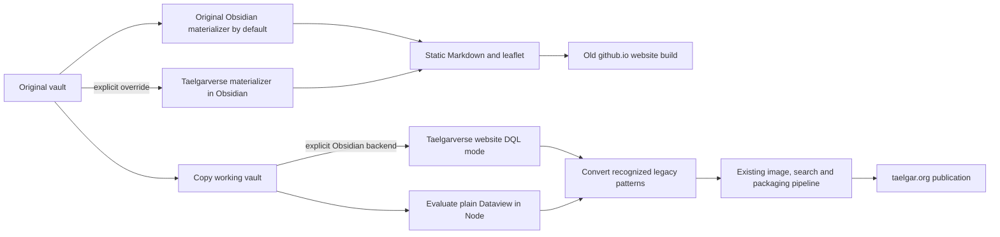

# Publishing pipelines

The original vault supplies two publication destinations with explicit materializer
choices. None rewrites source notes. Website compatibility conversion applies
only to the taelgar.org working copy.

| Pipeline | Entry point | Materializer | Destination |
| --- | --- | --- | --- |
| New website | `npm run publish -- --no-strict` in core | DQL in Node, then compatibility conversion | taelgar.org |
| New website with Obsidian DQL | `npm run publish -- --materializer obsidian --no-strict` in core | Taelgarverse's website DQL mode, then the same conversion | taelgar.org |
| Original static website | `./autobuild_website.sh deploy` in `taelgarverse` | Original `taelgar-dataview-materializer` plugin | GitHub Pages |
| Static website with native-block support | Same wrapper with `TAELGAR_MATERIALIZER` set as below | Taelgarverse's Obsidian materializer | Same GitHub Pages site |

The core publisher defaults to Node DQL and never falls back automatically.
`--materializer obsidian` explicitly selects the new plugin's website DQL mode.
Both feed the same Node conversion and publishing stages; neither runs the
legacy MkDocs publication pipeline. The npm command
is `npm run publish`; this private repository is not an npm package to publish.



## Old static website

The legacy entry point is `taelgarverse/autobuild_website.sh`. Its default
materialization script remains the vault's
`_scripts/materialize-dataview/materialize-dataview.mjs`, which selects only the
original `taelgar-dataview-materializer` plugin. Installing or enabling
Taelgarverse does not change that selection. Neither the old plugin nor its CLI
has been removed.

The existing workflow is:

1. `materialize`: Obsidian exports the vault into `taelgar-static/`.
2. `export`: `taelgar-utils/website/build_site.py --config website.json export`
   converts that tree into `docs/` with the existing filters, templates and assets.
3. `deploy`: materialize, export, commit generated website files, and push.
   The existing GitHub Actions workflow builds MkDocs and deploys GitHub Pages.

`build` runs the first two steps locally. `publish` exports the current
`taelgar-static/` and commits/pushes it without refreshing materialization.
`serve` exports the current tree and serves it with MkDocs. The wrapper also
retains its existing mamba setup and `taelgar-utils` pull before these commands.

To opt in to the new materializer for one run, use the wrapper's existing
`TAELGAR_MATERIALIZER` override. From the `taelgarverse` repository, with core
beside it:

```sh
TAELGAR_MATERIALIZER="$PWD/../taelgarverse-core/scripts/materialize-static.mjs" ./autobuild_website.sh build
```

Use `deploy` instead of `build` when intentionally publishing. The override only
affects commands that materialize (`materialize`, `build`, `deploy`); setting it
for `export`, `serve` or `publish` does not refresh existing static output. An
inline environment assignment applies only to that invocation. An exported
`TAELGAR_MATERIALIZER` must be unset to return to the default.

The selected Taelgarverse materializer requires the updated plugin to be enabled
in the same Obsidian vault. It fails explicitly if unavailable; it does not
silently switch back to the old plugin. Both choices use the same downstream
static exporter, MkDocs configuration and GitHub Pages workflow. Neither uses
the new website's Node DQL/conversion steps.

For a standalone export from core:

```sh
npm run materialize:static -- --vault ../taelgar --out ../taelgar-static --date 1750-01-01 --no-strict
```

This creates local export files. It does not build or publish GitHub Pages,
commit, push, or contact Cloudflare. Keep the existing downstream static-site
build and its configuration. The CLI retains the older export flags and default
`website` header format; `--header-type static` selects the plain static format.
Native `taelgar-header` callouts honor those formats:
`website` emits the GitHub Pages card layout and icon markup, while `static`
emits an ordinary Markdown information callout. Native headers use the shared
core and are not regenerated a second time through CustomJS.
Use a disposable output directory when testing.

Both desktop choices need the existing Dataview and CustomJS runtime for legacy
scripts. Taelgarverse exposes `plugin.materializer.runRequest(request)`. Its CLI
retains the old export arguments so the wrapper can select it without other
pipeline changes. The following native-block behavior applies to the opt-in
materializer:

| Input | Static export |
| --- | --- |
| `taelgar-header` | Shared-core information component (without title/pronunciation) in the selected format: GitHub Pages cards/icons for `website` (CLI default), or a Markdown information callout for `static`. |
| `taelgar-index` | Markdown table from the shared dated index model; grids have a table fallback. `show: obsidian` is omitted. |
| `taelgar-interactions` | Campaign headings and ordinary Markdown event/source links. |
| `taelgar-map` | Change only the fence language to `leaflet`; preserve configuration, quote prefixes and line endings. |
| `dataview` | Existing Dataview Markdown evaluation. |
| Supported `dataviewjs`, views and inline expressions | Existing capturing adapter and CustomJS behavior. Unsupported DOM-dependent scripts retain their existing reports. |
| Saved legacy header, old header fence or HTML marker | Preserved as source; never recognized or regenerated as a native header. |

Native blocks that fail remain in partial output and produce errors. Strict
mode prevents writing partial exports. Output must be outside the vault, cannot
contain the vault, and cannot be a filesystem root or contain symlinks. The
manual Obsidian command is an audit, not a note rewrite.

## taelgar.org

Choose the query engine explicitly, or omit the option for Node:

```sh
npm run publish -- --no-strict
npm run publish -- --materializer obsidian --no-strict
```

The Obsidian option needs the source vault open, Dataview enabled and indexed,
the current Taelgarverse plugin installed/reloaded, and Obsidian's command line
interface enabled. `--obsidian-command PATH` overrides executable detection;
`--obsidian-vault NAME_OR_ID` selects the same source vault. This mode uses the
installed Dataview plugin's version and settings, rather than Node's pinned
engine. CustomJS is not required for this DQL-only website mode.

The selected materializer and its dependency pin (or explicitly selected/installed
engine/plugin files) participate in the publication fingerprint. Switching backends rebuilds even for an unchanged
vault commit. A missing engine, disabled CLI, or unavailable plugin fails
explicitly; it never changes engines silently. Query-level failures retain
the same strict/`--no-strict` policy in both modes.

Both choices run these stages:

1. **Copy.** Create a request-owned working vault in core's `.cache/publish`.
   Copy ordinary source files and retain original Markdown creation/modification
   timestamps for Dataview. Skip dot directories, symlinks, folders beginning
   with `_`, and any folder containing `.nopublish`, including all descendants.
   Prune excluded folders before creating their destination or visiting children.
   A marker at the vault root produces an empty working copy. Explicit homepage,
   menu and session inputs still come from the original vault.
   Explicit `mapPath.source` references additionally copy their `.map-path.json`
   geometry inputs, including from underscore folders. No unrelated files from
   those folders are copied. References cannot bypass `.nopublish` or symlinks.
   Geometry is validated and compiled into note data, not exposed as an asset;
   content hashes participate in the publication fingerprint.
2. **Dataview.** Build an index from the remaining copied Markdown when using
   Node, or use the live Obsidian
   Dataview index. Evaluate plain DQL selected from website notes, skipping
   `excludePublish: all`. Do not execute DataviewJS. Strict
   errors apply no partial replacements; `--no-strict` reports failures and
   keeps the failed query blocks.
3. **Headers.** Convert eligible leading saved `[!info]` headers, empty legacy
   header fences and explicit HTML header markers through the shared saved-header
   writer. Existing native callouts and their authored titles remain unchanged.
   No Add operation runs. An ambiguous legacy boundary stops preparation with a
   per-file report, independently of the DQL `--no-strict` setting.
4. **Conversion.** Recognize complete supported DataviewJS patterns. Write canonical native blocks to the prepared copy.
   Then apply the existing unmatched-JavaScript/empty-heading cleanup policy.
5. **Existing preparation.** Discover images, generate derivatives and maps,
   compile backlinks/search/runtime data, and package the revision as before.
6. **Publication.** Only a normal, explicitly authorized publish run uploads and
   activates content. Build-only performs no R2/D1 reads or writes.

Node query inputs therefore exclude underscore and marked folders. Obsidian's
live index can still include them, so queries that depend on those notes can
differ between backends. The standalone comparison harness deliberately retains
its full-vault diagnostic index; it does not set publication copy policy.

The default Node backend runs without a running Obsidian process. DQL uses the
reviewed Dataview 0.5.68 bundle, pinned by version and SHA-256. Its plugin lifecycle,
UI, workers, IndexedDB and timers are not started. The metadata adapter and
importer supply the query engine's inputs. Unsupported host APIs fail explicitly.
The VM is a compatibility context for a trusted dependency, not an untrusted-code
sandbox. CSV/network sources are outside the supported adapter.

By default, the Node backend downloads the exact official GitHub 0.5.68 release
into core's `.cache/dataview/0.5.68` on its first DQL evaluation. Both `main.js`
and `manifest.json` have pinned SHA-256 checksums. Downloads are verified and
staged before the complete directory is installed; concurrent callers can share
the cache. Every reuse verifies both files without a network request. A valid
cache therefore works offline. When no DQL needs evaluation, no engine is loaded
or downloaded.

The default uses Dataview's built-in settings. It never reads the vault's
Dataview plugin or `data.json`, and ignores any `data.json` placed in the managed
cache. The fixed release pin and default-settings policy enter the fingerprint,
so downloading a missing cache does not invalidate an in-progress build.

An offline cache miss or corrupt/modified cache stops preparation with an
actionable error, including under `--no-strict`. A corrupt cache is not executed
or silently replaced; remove only `.cache/dataview/0.5.68` and retry to download
a verified copy. There is no fallback to a vault installation or another version.

To prepare the cache before going offline, without building or publishing:

```sh
node scripts/cache-dataview.mjs
```

### Acquiring Dataview outside the vault

Automatic caching is the normal path. For a manually provisioned override,
download `main.js` and `manifest.json` from the official
[Dataview 0.5.68 release](https://github.com/blacksmithgu/obsidian-dataview/releases/tag/0.5.68)
into a separate directory, for example `.cache/dataview-manual`. These are the
compiled release assets, not the source-code ZIP. `styles.css` is unnecessary
for Node. The adapter checks version `0.5.68` and a reviewed `main.js` SHA-256
before executing it. The official release includes an inline source map;
Obsidian strips it from the installed file. Their executable code is identical,
and both exact `main.js` variants are accepted for explicit overrides. The
managed cache requires the official release's main and manifest checksums:

| Bundle | SHA-256 |
| --- | --- |
| Official GitHub release | `794e9eaede73920bb8d54b0eda4f5de2182d698cc638774500f24f14bcd4da0b` |
| Official GitHub manifest.json | `9235db47112da81b85591c79ecb9ae2574e5e72207056e976472f90616286185` |
| Installed copy without source map | `bcdb7a7882051a30427a3fa370533c1052019591e7551bcc12611bb9a726bbb3` |

Then select that copy:

```sh
npm run publish -- --dataview-directory .cache/dataview-manual --no-strict
```

No installed Dataview plugin or Obsidian app is needed for either Node path.
`--dataview-directory PATH` disables automatic downloading and selects only
that directory. Its optional `data.json` supplies Dataview settings; without it,
Dataview defaults apply. Point explicitly at the vault's installed Dataview
directory when comparing its exact saved settings. Explicit files/settings enter
the fingerprint. `--dataview-directory` applies only to the Node backend.

Upstream also publishes the [`obsidian-dataview` npm API package](https://blacksmithgu.github.io/obsidian-dataview/resources/develop-against-dataview/).
That package provides plugin-facing API helpers, types and utilities; its
`getAPI()` accesses Dataview inside Obsidian. It is not the compiled plugin
bundle this adapter loads, and installing it alone does not supply our required
`main.js` and manifest. A different source/npm integration would need a separate
adapter and compatibility checks. Automatic downloads use the pinned GitHub
release assets, rather than npm or a floating latest version.

### Local comparison

Local validation:

```sh
npm run publish -- --build-only --allow-dirty --no-strict
npm run publish -- --materializer obsidian --build-only --allow-dirty --no-strict
```

Both commands prepare a complete local revision without contacting R2/D1.
For an interactive local Worker preview, use `npm run dev -- --full` or
`npm run dev -- --full --materializer obsidian`. Either can use `--plugin` to
install/reload the current local plugin first; Node itself does not need it.

The new materializer has distinct static and website modes. Full static export
flattens native headers/indexes/interactions and maps for GitHub Pages. Website
mode returns only DQL results: native blocks, saved headers and DataviewJS remain
intact until Node's separate compatibility conversion. Consequently both website
backends retain dynamic native headers/indexes and the same reported unmatched-JS
omission policy. Node retains its current-page chronology-scan limitation;
the Obsidian backend passes every selected closed DQL block to the installed
Dataview engine, including `file.lists` and `this.file.name` chronology queries.
Dataview errors and per-query timeouts use the normal strict/`--no-strict`
handling. Selecting Obsidian does not enable arbitrary DataviewJS execution on
taelgar.org.

Before copy-time folder exclusions and removal of the Obsidian chronology
pre-filter, the local full-vault comparison produced
2,907 notes per backend, with 2,901
byte-identical. Five timeline/list pages differed (including Mirror Visions),
and Conclave War's unsorted list differed only in row order. Timeline queries
are outside the Node parity guarantee: some are explicitly skipped, while other
`file.lists` queries can produce differing content or whitespace. The non-timeline
comparison harness remains the supported parity corpus. Both builds retained
the existing malformed query and five explicitly unsupported scans in their
reports; 76 rendered views per backend passed native-block rendering checks.

After success, `.cache/publish/materialization-report.json` contains DQL results
and errors; `conversion-report.json` contains every recognized rewrite and
unmatched script location. `.cache/cloudflare/header-conversion-report.json`
contains header changes, normal skips and problems, including after a header
failure. The materialization report records `backend` and
engine identity. Failed runs retain their working directory for
inspection. Successful runs remove that temporary copy.

Conversion can also run independently on a copied vault inside core:

```sh
node scripts/convert-website.mjs --source .cache/my-working-vault
```

It refuses the original vault. Its report is saved beside that working copy.
This standalone command runs DataviewJS conversion/cleanup only; automatic
legacy header migration belongs to the content-preparation pipeline.
Shared header metadata, homepage/navigation and session inputs still come from
the configured original vault. They are file inputs, not calls to Obsidian.

## Conversion contract

`src/website-compatibility.mjs` parses JavaScript with Acorn and never evaluates
it. A supported table must be a complete `const {util} = customJS; dv.table(...)`
pipeline with known columns, formatting calls, one supported predicate and
optional supported sort calls. Extra code, extra predicates, historical
membership filters, different columns, or unknown calls prevent conversion.

Current rules cover:

- Supported current-membership tables become `taelgar-index` with `type: members`.
- Supported location tables become Residents, Places or Settlements indexes.
  Literal targets are preserved; a current-note target stays implicit. Targets
  must resolve to a group for Members or a place for location indexes.
- The plain campaign-interactions view call becomes `taelgar-interactions`.

Converted indexes use the native model, sorting, visibility rules and columns;
they are a deliberate website feature upgrade. They stay dynamic when readers
change date/campaign. They do not promise byte-identical legacy table output.
The static export path does not run these rewrites on existing DataviewJS.

The initial live corpus converts 39 of 155 DataviewJS blocks. The remaining 116
are listed before the existing omission policy removes them from new-site
publication. No arbitrary JavaScript fallback is introduced. Timeline redesign
is separate; Node's unsupported current-page chronology scans remain reported,
while Obsidian evaluates those DQL blocks normally.

Use the [Dataview comparison harness](../experiments/dataview/README.md) to extend
the Node adapter against actual plugin results. Add conversion rules only with
complete matching examples, near-miss rejection cases, and rendering checks.

### Header callout transition

Both website publication backends run `scripts/convert-website-headers.mjs`
during content preparation. It calls the shared Node saved-header writer on the
publication inputs; it never edits the original vault. Saved legacy headers,
closed empty `taelgar-header` fences and leading `<!-- taelgar:header -->` /
`<!-- taelgar-header -->` markers become an H1, optional pronunciation and a
native callout. The H1 and saved summary follow the same approved formats and
name/article defaults as the explicit regeneration command.
Successful legacy conversion also removes the obsolete top-level `headerVersion`
property from the prepared copy, preserving the remaining YAML. Source notes
and already-native headers remain unchanged by publication preparation.

Untagged notes and the excluded `session-note`, `meta`, `background`, `source`
and `story` tag roots are skipped before header detection. Notes excluded from
all publication are also skipped. Native callouts, including their authored
title, pronunciation and fallback, remain unchanged. Unmarked notes do not gain
headers. `headerVersion` alone does not opt a note in. Nonempty/unclosed legacy
fences or ambiguous saved-header boundaries require review and stop the build;
`--no-strict` only relaxes DQL handling.

Node and Worker rendering still recognize only explicit native callouts. Legacy
handling is confined to this preparation pass and the explicit source-rewrite
tooling. Deploy the website code, then republish content to restore converted
headers; a temporary regression against an older published revision is possible.
No vault-wide source migration or vault commit is required for the header
transition. An already-migrated vault continues to publish normally.

For the old static website, select the **Taelgarverse** materializer via the
wrapper override described above. Its `website` mode emits website information
layout; `static` emits the Obsidian-style information callout. Both preserve
surrounding authored title/pronunciation and prose. The original standalone
vault materializer does not implement the new callout contract. Its legacy
header-regeneration path is not a fallback in the Taelgarverse materializer.
See [header conversion requirements](header-callout-migration.md) before rollout.
