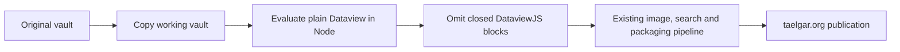

# Publishing pipelines

The taelgar.org publisher evaluates Dataview queries in Node against a working
copy of the vault. The **Publish vault content** workflow in the `taelgar`
repository checks out this publisher and runs it on GitHub Actions.



## taelgar.org

Run the publisher from core:

```sh
npm run publish -- --no-strict
```

The publication fingerprint covers the publisher's transitive local imports,
`package-lock.json`, publication settings, and the pinned or explicitly selected
Dataview bundle. Changes to a nested compiler module trigger a rebuild on the
next publication. Publication runs these stages:

1. **Copy.** Create a request-owned working vault in core's `.cache/publish`.
   Copy ordinary source files and retain original Markdown creation/modification
   timestamps for Dataview. Apply the [article and media selection rules](vault.md#files-the-website-uses),
   including exclusions for `Worldbuilding`, root `asset/dm` and `assets/dm`,
   `AGENTS.md`, underscore folders, dot entries, symlinks, and `.nopublish` subtrees.
   Prune excluded folders before creating their destination or visiting children.
   A marker at the vault root produces an empty working copy. Explicit homepage,
   menu and session inputs still come from the original vault.
   Explicit `mapPath.source` references additionally copy their `.map-path.json`
   geometry inputs, including from underscore folders. No unrelated files from
   those folders are copied. References cannot bypass `.nopublish` or symlinks.
   Geometry is validated and compiled into note data, not exposed as an asset;
   content hashes participate in the publication fingerprint.
2. **Dataview.** Use the article store's file list for link resolution and its
   Markdown pages for query input. Evaluate plain DQL against those pages.
   The retired `excludePublish` field has no effect. Do not execute DataviewJS. Strict
   errors apply no partial replacements; `--no-strict` reports failures and
   keeps the failed query blocks.
3. **Markdown cleanup.** Omit closed DataviewJS blocks and remove headings
   left empty by their omission. Authored native blocks pass through to the renderer.
4. **Existing preparation.** Discover images, generate derivatives and maps,
   compile backlinks/search/runtime data, and package the revision as before.
5. **Publication.** Only a normal, explicitly authorized publish run uploads and
   activates content. Build-only performs no R2/D1 reads or writes.

The standalone comparison harness uses a full-vault diagnostic index.
Publication queries use only the Markdown accepted by the article store.

The publisher runs DQL with the reviewed Dataview 0.5.68 bundle, pinned by
version and SHA-256. Its plugin lifecycle,
UI, workers, IndexedDB and timers are not started. The metadata adapter and
importer supply the query engine's inputs. Unsupported host APIs fail explicitly.
The VM is a compatibility context for a trusted dependency, not an untrusted-code
sandbox. CSV/network sources are outside the supported adapter.

By default, the publisher downloads the exact official GitHub 0.5.68 release
into core's `.cache/dataview/0.5.68` on its first DQL evaluation. Both `main.js`
and `manifest.json` have pinned SHA-256 checksums. Downloads are verified and
staged before the complete directory is installed; concurrent callers can share
the cache. Every reuse verifies both files without a network request. A valid
cache therefore works offline. When no DQL needs evaluation, no engine is loaded
or downloaded.

The default uses Dataview's built-in settings. It never reads the vault's
Dataview plugin or `data.json`, and ignores any `data.json` placed in the managed
cache. The fixed release pin and default-settings policy enter the fingerprint,
so downloading a missing cache does not invalidate an in-progress build.

An offline cache miss or corrupt/modified cache stops preparation with an
actionable error, including under `--no-strict`. A corrupt cache is not executed
or silently replaced; remove only `.cache/dataview/0.5.68` and retry to download
a verified copy. There is no fallback to a vault installation or another version.

To prepare the cache before going offline, without building or publishing:

```sh
node scripts/cache-dataview.mjs
```

### Acquiring Dataview outside the vault

Automatic caching is the normal path. For a manually provisioned override,
download `main.js` and `manifest.json` from the official
[Dataview 0.5.68 release](https://github.com/blacksmithgu/obsidian-dataview/releases/tag/0.5.68)
into a separate directory, for example `.cache/dataview-manual`. These are the
compiled release assets, not the source-code ZIP. `styles.css` is unnecessary
for Node. The adapter checks version `0.5.68` and a reviewed `main.js` SHA-256
before executing it. The official release includes an inline source map;
Obsidian strips it from the installed file. Their executable code is identical,
and both exact `main.js` variants are accepted for explicit overrides. The
managed cache requires the official release's main and manifest checksums:

| Bundle | SHA-256 |
| --- | --- |
| Official GitHub release | `794e9eaede73920bb8d54b0eda4f5de2182d698cc638774500f24f14bcd4da0b` |
| Official GitHub manifest.json | `9235db47112da81b85591c79ecb9ae2574e5e72207056e976472f90616286185` |
| Installed copy without source map | `bcdb7a7882051a30427a3fa370533c1052019591e7551bcc12611bb9a726bbb3` |

Then select that copy:

```sh
npm run publish -- --dataview-directory .cache/dataview-manual --no-strict
```

`--dataview-directory PATH` disables automatic downloading and selects only
that directory. Its optional `data.json` supplies Dataview settings; without it,
Dataview defaults apply. Point explicitly at the vault's installed Dataview
directory when comparing its exact saved settings. Explicit files/settings enter
the fingerprint.

Upstream also publishes the [`obsidian-dataview` npm API package](https://blacksmithgu.github.io/obsidian-dataview/resources/develop-against-dataview/).
That package provides plugin-facing API helpers, types and utilities; its
`getAPI()` accesses Dataview inside Obsidian. It is not the compiled plugin
bundle this adapter loads, and installing it alone does not supply our required
`main.js` and manifest. A different source/npm integration would need a separate
adapter and compatibility checks. Automatic downloads use the pinned GitHub
release assets, rather than npm or a floating latest version.

### Local validation

Local validation:

```sh
npm run publish -- --build-only --allow-dirty --no-strict
```

This command prepares a complete local revision without contacting R2 or D1.
Use `npm run dev -- --full` for an interactive preview with local Worker storage.

After a successful build, `.cache/publish/materialization-report.json` records
DQL results, errors, and engine identity. The vault workflow collects the cleanup
report under its existing filename, `.cache/publish/conversion-report.json`.
Version 2 lists each omitted DataviewJS block by file and line in the materialized
Markdown body and counts headings removed. Failed runs retain the working directory for
inspection. Successful runs remove the temporary copy.

Shared header metadata, homepage/navigation and session inputs still come from
the configured original vault. They are file inputs, not calls to Obsidian.

## Website secret filtering

The publisher removes raw vault secret blocks and frontmatter lines marked
`##secret` from its working Markdown copy before Dataview reads it. It applies
the same filtering to website homepages, navigation, and Markdown read from the
source vault for campaign data. Quick preview also filters notes when reading
the live vault. The source files and Git secret sidecars stay untouched.

Ordinary Obsidian comments and `Campaign:none` blocks remain available through
**See Behind the Curtain**. Use a single-line value for secret frontmatter.
Malformed secret syntax in a publishable article stops the build with a file
and line number. A new publication is required to replace an existing snapshot.

## Markdown cleanup

DQL selection and DataviewJS cleanup share Markdown-it fence boundaries,
including lists and block quotes. The publisher omits closed DataviewJS fences
and headings emptied by their removal. It preserves enclosing list and quote
prefixes, surrounding prose, and fenced or indented code examples.

Use `taelgar-index` for tables that follow the reader's selected date and campaign.
The website generates [campaign interactions](campaign-interactions.md) from vault records.

The [Dataview comparison harness](../experiments/dataview/README.md) compares
plain DQL results from the Node adapter with the Obsidian plugin.

### Publishing header callouts

Publication takes the header format from the authored note.
Node and the Worker generate header information at render time from explicit
`taelgar-header` callouts. To update a saved header, use the
[saved header commands](deploy.md#saved-header-commands) on the source note before
publishing.

See the [header callout migration record](header-callout-migration.md) for the
history of the format.
