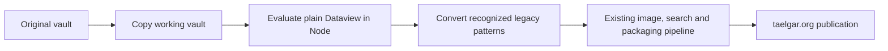

# Publishing pipelines

The taelgar.org publisher evaluates Dataview queries in Node against a working
copy of the vault. The **Publish vault content** workflow in the `taelgar`
repository checks out this publisher and runs it on GitHub Actions.



## taelgar.org

Run the publisher from core:

```sh
npm run publish -- --no-strict
```

The Dataview release pin or explicitly selected bundle and settings participate
in the publication fingerprint. Publication runs these stages:

1. **Copy.** Create a request-owned working vault in core's `.cache/publish`.
   Copy ordinary source files and retain original Markdown creation/modification
   timestamps for Dataview. Skip dot directories, symlinks, folders beginning
   with `_`, and any folder containing `.nopublish`, including all descendants.
   Prune excluded folders before creating their destination or visiting children.
   A marker at the vault root produces an empty working copy. Explicit homepage,
   menu and session inputs still come from the original vault.
   Explicit `mapPath.source` references additionally copy their `.map-path.json`
   geometry inputs, including from underscore folders. No unrelated files from
   those folders are copied. References cannot bypass `.nopublish` or symlinks.
   Geometry is validated and compiled into note data, not exposed as an asset;
   content hashes participate in the publication fingerprint.
2. **Dataview.** Build an index from the remaining copied Markdown in Node.
   Evaluate plain DQL selected from the included website notes.
   The retired `excludePublish` field has no effect. Do not execute DataviewJS. Strict
   errors apply no partial replacements; `--no-strict` reports failures and
   keeps the failed query blocks.
3. **Conversion.** Recognize complete supported DataviewJS patterns and write
   canonical native blocks to the prepared copy. Then apply the existing
   unmatched-JavaScript/empty-heading cleanup policy.
4. **Existing preparation.** Discover images, generate derivatives and maps,
   compile backlinks/search/runtime data, and package the revision as before.
5. **Publication.** Only a normal, explicitly authorized publish run uploads and
   activates content. Build-only performs no R2/D1 reads or writes.

The standalone comparison harness uses a full-vault diagnostic index.
Publication queries use only the copied Markdown.

The publisher runs DQL with the reviewed Dataview 0.5.68 bundle, pinned by
version and SHA-256. Its plugin lifecycle,
UI, workers, IndexedDB and timers are not started. The metadata adapter and
importer supply the query engine's inputs. Unsupported host APIs fail explicitly.
The VM is a compatibility context for a trusted dependency, not an untrusted-code
sandbox. CSV/network sources are outside the supported adapter.

By default, the publisher downloads the exact official GitHub 0.5.68 release
into core's `.cache/dataview/0.5.68` on its first DQL evaluation. Both `main.js`
and `manifest.json` have pinned SHA-256 checksums. Downloads are verified and
staged before the complete directory is installed; concurrent callers can share
the cache. Every reuse verifies both files without a network request. A valid
cache therefore works offline. When no DQL needs evaluation, no engine is loaded
or downloaded.

The default uses Dataview's built-in settings. It never reads the vault's
Dataview plugin or `data.json`, and ignores any `data.json` placed in the managed
cache. The fixed release pin and default-settings policy enter the fingerprint,
so downloading a missing cache does not invalidate an in-progress build.

An offline cache miss or corrupt/modified cache stops preparation with an
actionable error, including under `--no-strict`. A corrupt cache is not executed
or silently replaced; remove only `.cache/dataview/0.5.68` and retry to download
a verified copy. There is no fallback to a vault installation or another version.

To prepare the cache before going offline, without building or publishing:

```sh
node scripts/cache-dataview.mjs
```

### Acquiring Dataview outside the vault

Automatic caching is the normal path. For a manually provisioned override,
download `main.js` and `manifest.json` from the official
[Dataview 0.5.68 release](https://github.com/blacksmithgu/obsidian-dataview/releases/tag/0.5.68)
into a separate directory, for example `.cache/dataview-manual`. These are the
compiled release assets, not the source-code ZIP. `styles.css` is unnecessary
for Node. The adapter checks version `0.5.68` and a reviewed `main.js` SHA-256
before executing it. The official release includes an inline source map;
Obsidian strips it from the installed file. Their executable code is identical,
and both exact `main.js` variants are accepted for explicit overrides. The
managed cache requires the official release's main and manifest checksums:

| Bundle | SHA-256 |
| --- | --- |
| Official GitHub release | `794e9eaede73920bb8d54b0eda4f5de2182d698cc638774500f24f14bcd4da0b` |
| Official GitHub manifest.json | `9235db47112da81b85591c79ecb9ae2574e5e72207056e976472f90616286185` |
| Installed copy without source map | `bcdb7a7882051a30427a3fa370533c1052019591e7551bcc12611bb9a726bbb3` |

Then select that copy:

```sh
npm run publish -- --dataview-directory .cache/dataview-manual --no-strict
```

`--dataview-directory PATH` disables automatic downloading and selects only
that directory. Its optional `data.json` supplies Dataview settings; without it,
Dataview defaults apply. Point explicitly at the vault's installed Dataview
directory when comparing its exact saved settings. Explicit files/settings enter
the fingerprint.

Upstream also publishes the [`obsidian-dataview` npm API package](https://blacksmithgu.github.io/obsidian-dataview/resources/develop-against-dataview/).
That package provides plugin-facing API helpers, types and utilities; its
`getAPI()` accesses Dataview inside Obsidian. It is not the compiled plugin
bundle this adapter loads, and installing it alone does not supply our required
`main.js` and manifest. A different source/npm integration would need a separate
adapter and compatibility checks. Automatic downloads use the pinned GitHub
release assets, rather than npm or a floating latest version.

### Local validation

Local validation:

```sh
npm run publish -- --build-only --allow-dirty --no-strict
```

This command prepares a complete local revision without contacting R2 or D1.
Use `npm run dev -- --full` for an interactive preview with local Worker storage.

After success, `.cache/publish/materialization-report.json` contains DQL results
and errors; `conversion-report.json` contains every recognized rewrite and
unmatched script location. The materialization report records `backend` and
engine identity. Failed runs retain their working directory for
inspection. Successful runs remove that temporary copy.

Conversion can also run independently on a copied vault inside core:

```sh
node scripts/convert-website.mjs --source .cache/my-working-vault
```

It refuses the original vault. Its report is saved beside that working copy.
This standalone command runs DataviewJS conversion and cleanup.
Shared header metadata, homepage/navigation and session inputs still come from
the configured original vault. They are file inputs, not calls to Obsidian.

## Conversion contract

Query selection and JavaScript conversion and cleanup share Markdown-it fence
boundaries, including list/quote containers and CRLF source
offsets. Replacements preserve the enclosing list and quote prefixes. Outer
code examples and indented code are protected from query execution and cleanup;
unclosed query fences are reported rather than materialized.

`src/website-compatibility.mjs` parses JavaScript with Acorn and never evaluates
it. A supported table must be a complete `const {util} = customJS; dv.table(...)`
pipeline with known columns, formatting calls, one supported predicate and
optional supported sort calls. Extra code, extra predicates, historical
membership filters, different columns, or unknown calls prevent conversion.

Current rules cover:

- Supported current-membership tables become `taelgar-index` with `type: members`.
- Supported location tables become Residents, Places or Settlements indexes.
  Literal targets are preserved; a current-note target stays implicit. Targets
  must resolve to a group for Members or a place for location indexes.
- The plain campaign-interactions view call becomes `taelgar-interactions`.

Converted indexes use the native model, sorting, visibility rules and columns;
they are a deliberate website feature upgrade. They stay dynamic when readers
change date/campaign. They do not promise byte-identical legacy table output.

The initial live corpus converts 39 of 155 DataviewJS blocks. The remaining 116
are listed before the existing omission policy removes them from new-site
publication. The DQL report lists unsupported current-page chronology scans.

Use the [Dataview comparison harness](../experiments/dataview/README.md) to extend
the Node adapter against actual plugin results. Add conversion rules only with
complete matching examples, near-miss rejection cases, and rendering checks.

### Publishing header callouts

Publication takes the header format from the authored note.
Node and the Worker generate header information at render time from explicit
`taelgar-header` callouts. To update a saved header, use the
[saved header commands](deploy.md#saved-header-commands) on the source note before
publishing.

See the [header callout migration record](header-callout-migration.md) for the
history of the format.
